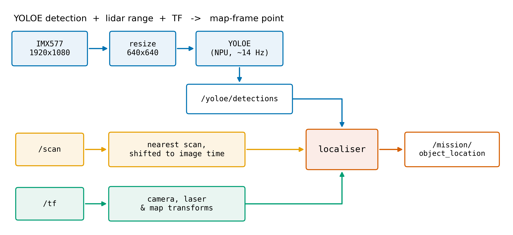
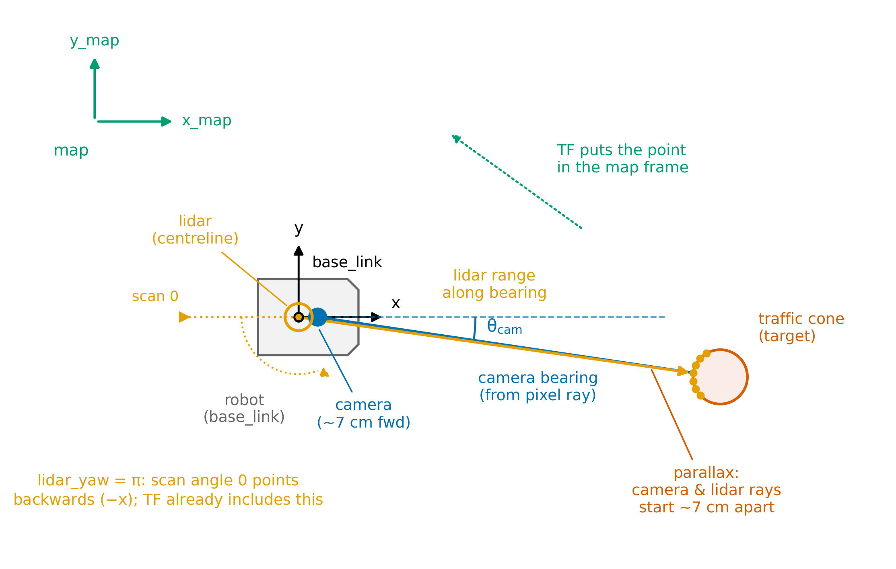

# YOLOE to a map-frame point (Part 3 guide)

Nov 12, 2026 · @Brian Deegan

Turn a YOLOE detection into an (x, y) point in the map frame and publish it once on `/mission/object_location`. The camera tells you which direction the object is in, the lidar points in that direction give you its position, and TF puts the result in the map.

This is a guide, not a spec, and none of it is graded. Milestone 3 is Friday 20 November: a lidar-on-image overlay, and a listed object located and published in the practice arena.

The arena has two rooms. The target is in Room 2; Room 1 contains a distractor that you must not report. The published floor plan gives the room boundaries, and you'll use Room 2's to gate your estimates in step 8.

**What you'll learn.** By the end you should be able to: check a published camera model against the image it claims to describe, and calibrate one yourself; measure a camera-to-lidar extrinsic and verify it visually; turn a pixel into a ray in another sensor's frame; associate a detection with the right lidar points; use TF at a past time to undo the robot's motion; and build an error budget from your own data.

**Before you start.** You should be comfortable with ROS 2 topics, parameters and launch files, TF2 frames and `tf2_echo`, the pinhole camera model (focal length, principal point, the K matrix), and NumPy. The fleet's robots already ship the mission model, so you don't need a Qualcomm AI Hub account unless you choose the optional export in step 1d — that step alone needs an account and a roughly 6 GB Python environment on your laptop.

Steps 1 to 4 each end with a **Done when** check. Don't move on until it passes: a problem caught at its own step is much cheaper than the same problem found in the error budget. Steps 5 to 8 have checks too, but you run them against the localiser from step 9 (see the start of step 5).

The QB3rt repo already gives you the detector. `launch/yolo_npu.launch.py` runs YOLOE on the NPU (about 12 Hz) and publishes `/yoloe/detections`. It does not give you a camera frame in TF, a camera-to-lidar extrinsic, or anything that turns a box into a point. That's what you build. Read `docs/yolo_npu.md` in the repo first.



Assumptions in this guide, which I haven't run on a robot:

- The robots ship a mission model, `yoloe_mission_qa250.bin`, whose vocabulary covers the **target — "traffic cone" — plus the other objects present: "car", "traffic light", "pedestrian", "cyclist", "dog", "cat"**. Detecting the non-target objects too is useful: their detections are evidence the pipeline is healthy, and the localiser ignores them, since it reports only the target. Exporting your own model is optional (step 1d).
- The IMX577 (camera_id 0) is the wide-angle colour camera — the OV9282 is mono and can't feed this pipeline anyway. A `camera_info_imx577.yaml` ships on the robot, but treat its numbers as placeholders and calibrate the camera yourself (step 2).
- You measure the camera mount yourself, as the brief allows.

## What YOLOE is, and why the vocabulary isn't fixed

YOLOE is an **open-vocabulary** detector. Older YOLO versions (v8, v11) learn a fixed class list at training time — the last layer is a classifier over, say, the 80 COCO names, and changing that list means collecting data and retraining. YOLOE instead takes the class names as **text prompts**: a small text encoder embeds each name ("traffic cone", "waste bin"), and the detector scores image regions against those embeddings rather than against a frozen softmax head. The same weights can detect a new object class just by being asked for it — no retraining, no new dataset.

Two practical consequences on this stack:

- **Vocabulary is chosen at export, not at training.** The Qualcomm pipeline bakes the prompt embeddings into the `.bin`: `yoloe_lab` was exported with `--prompt-text "door, hallway sign, trash bin, fire extinguisher, person"`. To change the vocabulary you **re-export** the model on AI Hub with a different prompt text — a few minutes, no retraining — you do *not* need to fine-tune weights. You cannot change the vocabulary by editing the label YAML; that file only maps output indices to display strings.
- **The class name is the query.** Detection behaviour depends on the actual words in the prompt, so wording matters: "waste bin" and "trash bin" may detect differently, and oddly-worded classes can underperform. When the brief names an object, the mission model should be prompted with exactly that phrasing — the fleet's `yoloe_mission_qa250.bin` is, and so should any export of your own (1d).

There is also a prompt-free YOLOE variant that labels regions from a built-in vocabulary, but everything here uses explicit text-prompt exports.

## 1. Get YOLOE running and prove the vocabulary

Nothing downstream works until the detector is healthy and calling things by the right names, so spend real time here before touching geometry. You first prove the pipeline with the fleet's known-good COCO model, then run the fleet's mission model the same way (1a–1c). Step 1d is optional — exporting your own model on AI Hub — and 1e checks the message stamps.

### 1a. Preflight (on the robot)

Log in with an interactive `ssh ubuntu@<unit>` and work there. A login shell sets up ROS, the domain and CycloneDDS via `/etc/profile.d/qb3rt-ros-env.sh`; a one-shot `ssh <unit> '...'` doesn't, so wrap those in `bash -lc "..."`. Before launching anything, run this checklist:

```bash
echo $ROS_DOMAIN_ID; cat /etc/qb3rt/domain_id        # should match
ros2 topic list | grep -E '^/(scan|tf)$'              # robot stack is up
ls -l /home/ubuntu/models/                            # yoloe_coco80_qa249.bin, yoloe_lab_qa249.bin, yoloe_mission_qa250.bin
ls /opt/qairt-2.50/lib/libQnnHtp.so                   # QAIRT 2.50 runtime, needed for the mission model
ros2 launch QB3rt yolo_npu.launch.py --show-args | grep -A1 qairt   # launch file has the qairt argument
C=/opt/qb3rt/install/share/QB3rt/config
cat $C/yoloe_mission.yaml $C/yoloe_mission_quant.yaml
qb3rt-status                                  # full_stack running, no yolo_npu add-on yet, no orphans
```

If `/scan` and `/tf` don't show up, start the robot's base stack with `qb3rt-up full_stack`, then rerun the checklist. If the mission bin, `/opt/qairt-2.50` or the `qairt` argument is missing, the robot hasn't had the latest update: ask a demonstrator. `$C` only lasts for that shell, so set it again in any new terminal.

- **Architecture check.** The fleet's DSP is V68. A model exported for V73 fails to load with `Request feature arch with value 73 unsupported` — if you get an `Inference graph init fail` right at startup, that's the first suspect. A 2.50 model on a unit without `/opt/qairt-2.50` (or launched with `qairt:=system`) fails with `Using newer context binary on old SDK` followed by `Inference graph init fail`; check the QAIRT backend line in `journalctl -u qb3rt-addon@yolo_npu`. If the mission model won't load, fall back to `yoloe_coco80_qa249.bin` (known-good V68 build) to prove the pipeline while the model is rebuilt.
- **The label file must list classes in the same order the model was exported with**, because the localiser's `target` parameter (step 9) is compared against the published names. Any detection index missing from the file is published as a bare number string, so a misaligned label file fails *silently*.

### 1b. Launch

Run the launch twice over 1b/1c: first the fleet's COCO model, then the fleet's mission model. `$C` is the config directory defined in 1a. YOLOE runs as a service beside `full_stack` — `qb3rt-up --addon` starts it as the `qb3rt-addon@yolo_npu` unit without stopping the base stack. Its log is `journalctl -u qb3rt-addon@yolo_npu -f`, which is where the QAIRT backend line and the `Hz in` rates appear. Stop it with `qb3rt-down --addon yolo_npu`; rerunning `qb3rt-up --addon ...` restarts it, which is how you switch models or turn the overlay on for steps 2 and 4. A restart waits about 90 s for the NPU to settle after the previous instance stops — that wait is built in, so just rerun the command. If the add-on dies (the overlay crash below, or a hardware fault) it drops out of `qb3rt-status` instead of looking alive but doing nothing. Note that a main `qb3rt-up` or a plain `qb3rt-down` also stops the add-on, so restart it afterwards.

COCO first:

```bash
qb3rt-up --addon yolo_npu \
  model:=/home/ubuntu/models/yoloe_coco80_qa249.bin \
  label_file:=$C/yoloe_coco80.yaml \
  quant_params_file:=$C/yoloe_coco80_quant.yaml \
  enable_overlay:=false
```

Then the mission model (a QAIRT 2.50 build — `qairt:=auto` picks `/opt/qairt-2.50` automatically):

```bash
qb3rt-up --addon yolo_npu \
  model:=/home/ubuntu/models/yoloe_mission_qa250.bin \
  label_file:=$C/yoloe_mission.yaml \
  quant_params_file:=$C/yoloe_mission_quant.yaml \
  enable_overlay:=false
```

Two warnings from the field:

- **`enable_overlay:=true` can take the whole pipeline down.** The overlay component throws `Invalid bounding box(TLBR)` on any detection box poking outside the 640 frame, and because the camera, preprocess and inference share one process container, the abort kills all of them. Leave it `false` except when you need the annotated image — the resize check in step 2 and the extrinsic check in step 4 — and expect to restart it when it crashes.
- **After a crash, the NPU graph stays wedged for up to ~90 s.** A restart too soon fails with `Failed to find graph` / `Inference graph init fail` — `qb3rt-up --addon ...` already waits out the settle period, so just rerun it. Rebooting the DSP daemon (`sudo systemctl restart cdsprpcd`) alone doesn't clear it.

Check it's alive. The postprocess node publishes nothing when no detection passes the score threshold — not even an empty message — so silence with an empty view is normal. For the same reason, `ros2 topic hz` here measures the *detection* rate, not the ~12 Hz inference rate (the postprocess node logs the inference rate every 5 s as `Hz in`); frames with no detections don't count:

```bash
ros2 topic hz /yoloe/detections        # with a target object in view
ros2 topic echo /yoloe/detections --once
```

### 1c. Prove the vocabulary

Do this twice, before any localisation work: first with the COCO model, to prove detections flow end to end and to practise the check, then with the fleet's mission model. On the COCO pass, expect "traffic cone" never to appear and the others to come out under COCO's names ("person", "bicycle"); that gap is why the fleet ships a mission model.

1. Put each listed object in view one at a time and `ros2 topic echo /yoloe/detections --once`. Record the `class_id` string **exactly** as published, with its typical score.
2. Check every name against the brief's list. Mismatches (a missing class, a renamed class, a bare number instead of a name) are mission-killers that are cheap to catch now — the `target` match in step 8 ignores case and extra spaces but nothing else, so "cone" will quietly never match "traffic cone".
3. Note the score spread per object. Your `min_score` and the confirmation threshold in step 8 should sit above the noise floor you actually observe, not the 0.25 default. Expect a wide spread even for a still object: a stationary traffic cone on qb3rt-42 scored between 0.26 and 0.60 (mean 0.48), so the 0.4 in step 8 would have thrown away a good share of its frames.

### 1d. Optional: export your own model on AI Hub

Do this step if you want to change or reword the vocabulary — "waste bin" instead of "trash bin", say — or simply to learn the export. It isn't needed for Milestone 3: the fleet's mission model was made exactly this way, with the prompt `"traffic cone, car, traffic light, pedestrian, cyclist, dog, cat"`. The export runs on Qualcomm AI Hub, a cloud service that compiles models for Qualcomm chips, driven from your laptop. You haven't used it before, so set it up first. Allow time and disk space: the Python environment is about 6 GB, and the export itself downloads about 700 MB more and takes roughly half an hour. Do the setup before the lab session.

**Set up AI Hub (once):** (laptop)

1. **Create an account.** Sign up at [aihub.qualcomm.com](https://aihub.qualcomm.com) with a Qualcomm ID (free).
2. **Copy your API token.** In AI Hub, open the settings page; the token is on the account tab. Treat it like a password: don't commit it or paste it into your report.
3. **Make a Python environment on your laptop.** It needs Python 3.10 to 3.13. These are the versions the fleet's own export was tested with (Python 3.12):

   ```bash
   python3 -m venv ~/aihub-venv
   source ~/aihub-venv/bin/activate
   pip install qai-hub-models==0.64.0
   pip install ultralytics==8.4.45 object-detection-metrics==0.4.post1 shapely==2.2.0 torchmetrics==1.9.0
   ```

   `qai-hub-models` brings in the `qai-hub` client and PyTorch. There is no `yoloe-seg` extra to install, despite what you may read elsewhere, and `clip` installs itself the first time you export.
4. **Store the token** in the client's config (`~/.qai_hub/client.ini`):

   ```bash
   qai-hub configure --api_token <your token>
   ```

5. **Check it works.** The RB3 Gen 2 should be in the list of cloud devices:

   ```bash
   qai-hub list-devices | grep "RB3 Gen 2"
   ```

   You should see `Dragonwing RB3 Gen 2 Vision Kit` with chipset `qualcomm-qcs6490`. An authentication error here means the token is wrong or not stored.

**Then export.** (laptop) Activate the environment (`source ~/aihub-venv/bin/activate`) and work from a scratch directory: the export downloads its weights into the current directory whatever `--output-dir` says.

1. **Choose the prompt text.** One comma-separated list, in the order you want indices assigned — index 0 is the first name. For this scene, include everything you might want reported or sanity-checked, e.g. `"traffic cone, car, traffic light, pedestrian, cyclist, dog, cat"` (see "The class name is the query" above). If a class underperforms, try other wordings with the local demo, `qai-hub-models demo yoloe_seg --prompt-text "..."`.
2. **Export on AI Hub** with the `qai-hub-models` `yoloe_seg` export, passing your list via `--prompt-text`. This is a compile job (weights unchanged, prompt embeddings re-computed), not a training run. Use the `qai-hub-models export` entry point; current releases no longer support `python -m qai_hub_models.models.yoloe_seg.export`:

   ```bash
   # in an env with qai-hub-models and a configured AI Hub API token
   qai-hub-models export yoloe_seg \
       --prompt-text "traffic cone, car, traffic light, pedestrian, cyclist, dog, cat" \
       --chipset qualcomm-qcs6490 \
       --target-runtime qnn_context_binary \
       --precision w8a8 \
       --output-dir <dir>
   ```

   For a quantized precision the export adds `--quantize_io` and `--force_channel_last_output` itself, which is what the preprocess node (raw uint8 input) and the postprocess node (channel-last mask protos) expect.

   The result is a **Hexagon V68 context binary** built with **QAIRT 2.50**, the AI Hub default — check the `qairt:` line at the end of the output, or `tool_versions.qairt` in `metadata.json`. The fleet's packaged runtime is 2.49 and refuses 2.50 binaries, so the robots carry QAIRT 2.50 side-by-side in `/opt/qairt-2.50`, and `yolo_npu.launch.py` uses it automatically (`qairt:=auto`, logged at startup as the QAIRT backend). AI Hub no longer offers 2.49, so you can't build a model for the packaged runtime. The `.bin` lands at `<dir>/yoloe_seg-qnn_context_binary-w8a8-qualcomm_qcs6490/yoloe_seg.bin`; rename it `yoloe_mission_qa250.bin`.
3. **Collect three artifacts and keep them consistent:**
   - the `.bin` context binary;
   - a **label YAML** mapping index → name **in exactly the prompt order** (copy `config/yoloe_lab.yaml` as a template and rewrite the list);
   - the **quant YAML** matching the binary. Take the output scales and offsets from `metadata.json` in the same folder (`quantization_parameters`; the YAML offset is the negated `zero_point`), or generate it from the `.bin` on-unit with `qnn-context-binary-utility` as in `docs/yolo_npu.md`. Do not reuse a quant YAML from a different export.
4. **Deploy all three together** (laptop → robot):

   ```bash
   scp yoloe_mission_qa250.bin ubuntu@<unit>:/home/ubuntu/models/
   ```

   Keep your own label and quant YAMLs in a directory in your home on the robot (e.g. `~/yoloe/`) and pass their full paths to the 1b launch command.

5. **Launch with the new files** (robot, as in 1b) and run the 1c checklist again, against every class in your prompt order. If a class reports a bare number, its index is missing from the label YAML; if names are scrambled, the YAML order doesn't match the prompt order — the prompt order baked into the `.bin` is authoritative, so fix the YAML to match it.

### 1e. Message format and stamps

What's in each message (`qrb_ros_vision_msgs/Detection2DWithMaskArray`):

| Field | Meaning |
| --- | --- |
| `header.stamp` | Copied from the inference tensors. Check it equals the camera frame's stamp (below) |
| `array[i].detection.results[0].hypothesis.class_id` | Class name as a string |
| `array[i].detection.results[0].hypothesis.score` | 0 to 1. The launch default threshold is 0.25 |
| `array[i].detection.bbox.center.position.x/y`, `size_x/y` | The box in the **640 x 640 model frame**, not in camera pixels |
| `array[i].instance_mask` | Mono8 mask cropped to the box at 160 x 160 prototype resolution |

Check the stamps now, because the timing step depends on them. As a first look, compare the detection stamp with the camera's and with the scan's, and with the robot's clock:

```bash
ros2 topic echo /yoloe/detections --field header.stamp --once
ros2 topic echo /cam0_stream1 --field header.stamp --once
ros2 topic echo /scan --field header.stamp --once
date +%s
```

If the image stamps are seconds away from the scan stamps, they come from a different clock and every TF lookup at the image time will fail. Note it and fix it before going further.

Those commands each catch one message at a different moment, so they show the clocks agree roughly but can't show that a detection carries its camera frame's stamp. For that, pair each detection with the nearest camera frame and scan. Save this as `stamp_check.py` and run it on the robot while YOLOE is running:

```python
'''Pair each detection with the nearest camera frame and scan, and print the stamp gaps.'''
import collections

import rclpy
from qrb_ros_vision_msgs.msg import Detection2DWithMaskArray
from rclpy.node import Node
from rclpy.qos import qos_profile_sensor_data
from sensor_msgs.msg import Image, LaserScan


def secs(stamp):
    return stamp.sec + stamp.nanosec * 1e-9


class StampCheck(Node):
    def __init__(self):
        super().__init__('stamp_check')
        self.cam = collections.deque(maxlen=200)
        self.scan = collections.deque(maxlen=50)
        self.n = 0
        self.create_subscription(Image, '/cam0_stream1',
                                 lambda m: self.cam.append(secs(m.header.stamp)),
                                 qos_profile_sensor_data)
        self.create_subscription(LaserScan, '/scan',
                                 lambda m: self.scan.append(secs(m.header.stamp)),
                                 qos_profile_sensor_data)
        self.create_subscription(Detection2DWithMaskArray, '/yoloe/detections',
                                 self.on_detections, 10)

    def on_detections(self, msg):
        if not self.cam or not self.scan:
            return
        d = secs(msg.header.stamp)
        now = self.get_clock().now().nanoseconds * 1e-9
        c = min(self.cam, key=lambda x: abs(x - d))
        s = min(self.scan, key=lambda x: abs(x - d))
        print(f'det-cam {1e3 * (d - c):+8.2f} ms   det-scan {1e3 * (d - s):+8.2f} ms   '
              f'now-det {1e3 * (now - d):7.1f} ms', flush=True)
        self.n += 1
        if self.n >= 20:
            raise SystemExit


def main():
    rclpy.init()
    try:
        rclpy.spin(StampCheck())
    except SystemExit:
        pass


if __name__ == '__main__':
    main()
```

The first few lines can be off while the camera buffer fills. After that, `det-cam` should be exactly 0 (the detection carries its frame's stamp) and `det-scan` within ±50 ms (scans arrive at about 10 Hz). `now-det` is how long the detection took to reach you: on qb3rt-42 it was about 0.7 to 0.85 s. You'll need that number in step 7.

Don't use `date +%s` as a reference for wall time. The units have no internet time sync, and their clocks can be months out and can jump across a reboot (qb3rt-42 read July after a November reboot; see `docs/fleet_status.md`). What matters is that the camera, detection and scan stamps agree with each other and, if you also run nodes on the laptop, that the two machines' clocks agree.

**Done when:** the mission model loads, every scene object is detected under exactly the brief's name, `stamp_check.py` shows `det-cam` at 0 and `det-scan` within a fraction of a second, and you've noted your detection delay (`now-det`).

## 2. Camera model: intrinsics and the resize

The boxes are in a 640 x 640 frame that was made from a 1920 x 1080 image, so you need to undo the resize before the intrinsics mean anything. Mixing 640-frame pixels with 1920-frame intrinsics is the most common bug in this part.

The camera node reads a CameraInfo YAML and republishes it on `/cam0_stream1_camera_info`. Look at both the live topic and the file behind it:

```bash
ros2 topic echo /cam0_stream1_camera_info --once
cat $(ros2 pkg prefix qrb_ros_camera)/share/qrb_ros_camera/config/camera_info_imx577.yaml
```

Read `width`, `height`, `fx, fy, cx, cy`, `distortion_model` and the distortion coefficients from both, and ask whether they describe the image you actually receive. Two checks expose most problems:

- **Is the principal point near the image centre?** For a 1920 x 1080 stream, `cx, cy` should be near (960, 540). Values near the centre of some larger image mean the file describes the full sensor (the IMX577 is 4056 x 3040), not this stream.
- **Does the focal length agree with the field of view?** A pinhole camera with image width W and horizontal field of view HFOV has

```math
f_x = \frac{W/2}{\tan(\mathrm{HFOV}/2)}
```

Measure HFOV roughly yourself: stand two objects at the left and right edges of the image, measure their positions with a tape, and compute the angle. With lens distortion the formula is only approximate, but it easily catches a factor-of-two error. The sensor is 4:3 and the stream is 16:9, so the stream is at least cropped vertically, and probably also scaled. Scaling shrinks `fx` by the scale factor; cropping leaves `fx` alone and only moves `cx, cy`. Work out the scale and crop your stream uses: that tells you whether a published `fx` can possibly be right.

A file or topic can fail one check and pass the other — for example, a principal point recentred to (960, 540) with an `fx` left at its full-sensor value — so do both. Whatever you find, don't use the shipped numbers: you will replace them with your own calibration, kept in your own YAML rather than the install.

**Calibrate** with a checkerboard or ChArUco board at the 1920 x 1080 stream size, filling the whole image — corners and edges included, at several distances and tilts. Use `cv2.calibrateCamera` or Kalibr (as for the OV9282's `camera_info_ov9282.yaml`). Then decide the lens model from the data rather than from the label "wide-angle": fit both a `plumb_bob` model (`cv2.calibrateCamera`) and an `equidistant` fisheye model (`cv2.fisheye.calibrate`) to the same images, and compare their RMS reprojection errors and residuals at the image edges. A good calibration is well under 1 px RMS. Pick the model that fits better, and say why in the report. The image processor may already correct part of the distortion, which is one reason the answer isn't obvious in advance.

Sanity-check the result against your HFOV estimate and your expected `cx, cy`. If `fx` disagrees with the FOV by more than a few percent, recheck the board's square size and the image size you calibrated at.

Then find out how the preprocess node resized. The repo sets the target to 640 x 640 but the resize lives inside the `qrb_ros_cv_tensor_common_process` component, whose source isn't in this repo, so check it on the image rather than guessing. Restart the add-on with `enable_overlay:=true` (`qb3rt-up --addon yolo_npu ... enable_overlay:=true`, 1b) and first check what the overlay is drawn on: `ros2 topic echo /yoloe/overlay --field width --once` (and `--field height`). The launch file doesn't remap the overlay node's image input, so also run `ros2 node info /yoloe_overlay_node` to see which image it subscribes to. The rest of this check, and `project_scan.py` in step 4, assume a 640 x 640 overlay; if yours is 1920 x 1080, it can't show stretch or letterbox, and `project_scan.py` must skip `cam_to_model`. Then view `/yoloe/overlay` in RViz next to the raw camera image. If round things look oval, it's stretched; if there are black bars at the top and bottom, it's letterboxed. A decisive test: put a square object (a sticky note works) in front of the camera and measure its pixel width and height on the overlay — stretch makes it about 1.8 times taller than wide (the width is squeezed by 3, the height only by 1.69), letterbox keeps it square. The two mappings back to camera pixels are:

```math
\text{stretch: } u_c = 3u,\; v_c = 1.6875\,v \qquad
\text{letterbox: } u_c = 3u,\; v_c = 3\,(v - 140)
```

where (u, v) is a point in the 640-frame and (u\_c, v\_c) is the same point in the 1920 x 1080 image. The 140 is the padding at the top: (640 − 1080/3) / 2.

Then undistort. With distortion, the normalised ray is *not* `(u - cx)/fx`: feed the box edge pixels through the undistortion function that matches your model — `cv2.fisheye.undistortPoints` (k1..k4) for equidistant, `cv2.undistortPoints` (k1, k2, p1, p2, k3) for plumb_bob — with your calibrated K and no P, to get unit-plane coordinates, then form the ray. The scripts in steps 4 and 9 read a `distortion_model` parameter — `equidistant` or `plumb_bob` — so set it to your choice and give the matching number of coefficients (4 for equidistant, 5 for plumb_bob) in `distortion`. Distortion is smallest at the centre and largest at the edges, so compare your bearing with and without undistortion for an object at the centre and at the edge of the image, and put both numbers in the report.

**Done when:** your K and distortion coefficients are in your own YAML, the RMS reprojection error is well under 1 px, `fx` agrees with your HFOV estimate, `cx, cy` are near the image centre, and you know whether the 640 frame is stretched or letterboxed.

## 3. Measure the camera-to-lidar extrinsic

The repo's TF tree has frames for the OV9282 (`tracking_camera_frame`) and the OAK-D, but not for the IMX577 that YOLOE uses. The lab calibration (`T_cam_imu`) is for the OV9282, which can't feed YOLOE, so you can't chain from it here. Measure the IMX577 mount directly, which the brief allows, and verify it visually in step 4.

1. **Translation.** With a ruler, measure from the `base_link` origin to the middle of the lens: x forward, y left, z up. Remember `base_link` sits 0.085 m above the floor and the lidar is 0.170 m above `base_link` on the centreline.
2. **Tilt.** Put a phone inclinometer along the camera body for pitch, and check the roll by eye against a level line in the image. In ROS a negative pitch tilts the camera up (the repo's tracking camera uses −0.6163 rad).
3. **Yaw.** Put a thin vertical object on the robot's centreline about 1.5 m ahead. It is at zero bearing in `base_link` (in the raw scan that's ±π if your `lidar_yaw` is π — see item 5), so the image column it lands in tells you the camera's yaw error.
4. **Publish it as two static transforms**: one from `base_link` to a mount frame (x forward), one from the mount frame to the optical frame (z forward, x right, y down). The second one is the standard ROS optical rotation. Start them after `qb3rt-up full_stack`: a main `qb3rt-up` (or `qb3rt-down --force`) reaps hand-started ROS processes like `static_transform_publisher`, while `qb3rt-up --addon` does not. These numbers are placeholders:

```bash
ros2 run tf2_ros static_transform_publisher --x 0.07 --y 0.0 --z 0.12 \
  --roll 0 --pitch 0 --yaw 0 --frame-id base_link --child-frame-id imx577_frame
ros2 run tf2_ros static_transform_publisher --roll -1.5707963 --pitch 0 --yaw -1.5707963 \
  --frame-id imx577_frame --child-frame-id imx577_optical_frame
```

In the end these belong in your launch file with the numbers in YAML, not on the command line.

5. **Let TF compose the rest.** Ask TF for the transform between the lidar and the camera instead of working it out by hand. The lidar frame is rotated by `lidar_yaw`, which TF already includes — but check its value on your unit in `/etc/qb3rt/unit_conventions.yaml` rather than assuming. It is π on about half the fleet and 0 on the rest, and the guide's wrap-angle warnings below assume π:

```bash
ros2 run tf2_ros tf2_echo laser_frame imx577_optical_frame
```

Your measured numbers are only a starting point. Step 4 shows you how to refine them: yaw moves lidar points sideways in the image, pitch moves them up and down. Report the final values, how you got them and how big the remaining error looks.

**Done when:** `ros2 run tf2_ros tf2_echo base_link imx577_optical_frame` returns your measured translation and a rotation whose z axis (the optical axis) points forward along `base_link` +x, tilted by your measured pitch. That only proves the publishers are running and the optical rotation is right; it can't catch a bad measurement. The real test is step 4.

## 4. Check the extrinsic visually

Do this before you trust anything downstream. This script draws the lidar scan as green dots on top of `/yoloe/overlay` and publishes the result on `/localiser/projection`, which you can view as an Image display in RViz. It draws on the overlay (the 640-frame image) so you don't have to decode the camera's NV12 stream, and it applies the inverse of the step 2 resize, so it also tests whether you picked stretch or letterbox correctly. Both scripts in this guide share the camera and transform maths, so it lives in one module. Save it as `camera_geometry.py` next to them:

```python
'''Camera and transform helpers shared by project_scan.py and object_localiser.py.'''
import cv2
import numpy as np


def to_matrix(tf):
    '''geometry_msgs/TransformStamped -> 4x4 matrix.'''
    q, t = tf.transform.rotation, tf.transform.translation
    x, y, z, w = q.x, q.y, q.z, q.w
    R = np.array([
        [1 - 2 * (y * y + z * z), 2 * (x * y - z * w), 2 * (x * z + y * w)],
        [2 * (x * y + z * w), 1 - 2 * (x * x + z * z), 2 * (y * z - x * w)],
        [2 * (x * z - y * w), 2 * (y * z + x * w), 1 - 2 * (x * x + y * y)]])
    M = np.eye(4)
    M[:3, :3] = R
    M[:3, 3] = [t.x, t.y, t.z]
    return M


class CameraModel:
    '''Intrinsics, distortion and the 640-frame <-> camera-pixel resize.'''
    def __init__(self, intrinsics, distortion, model='equidistant', letterbox=False,
                 cam_size=(1920, 1080), model_size=(640, 640)):
        fx, fy, cx, cy = intrinsics
        if fx <= 0 or fy <= 0:
            raise ValueError('intrinsics are not set: fill in fx, fy, cx, cy '
                             'from your step 2 calibration')
        if model not in ('equidistant', 'plumb_bob'):
            raise ValueError('distortion_model must be equidistant or plumb_bob, '
                             f'not {model!r}')
        need = 4 if model == 'equidistant' else 5
        if len(distortion) != need:
            raise ValueError(f'{model} needs {need} distortion coefficients '
                             f'({"k1..k4" if need == 4 else "k1, k2, p1, p2, k3"}), '
                             f'got {len(distortion)}')
        self.K = np.array([[fx, 0, cx], [0, fy, cy], [0, 0, 1]], dtype=float)
        self.D = np.asarray(distortion, dtype=float)
        self.model = model
        self.letterbox = letterbox
        self.cw, self.ch = cam_size
        self.mw, self.mh = model_size

    def model_to_cam(self, u, v):
        '''640-frame pixel -> 1920x1080 camera pixel (undo the resize).'''
        u, v = np.asarray(u, dtype=float), np.asarray(v, dtype=float)
        s = self.cw / self.mw
        if self.letterbox:
            pad = (self.mh - self.ch / s) / 2.0
            return u * s, (v - pad) * s
        return u * s, v * (self.ch / self.mh)

    def cam_to_model(self, uc, vc):
        '''1920x1080 camera pixel -> 640-frame pixel (the inverse mapping).'''
        uc, vc = np.asarray(uc, dtype=float), np.asarray(vc, dtype=float)
        s = self.cw / self.mw
        if self.letterbox:
            pad = (self.mh - self.ch / s) / 2.0
            return uc / s, vc / s + pad
        return uc / s, vc * (self.mh / self.ch)

    def undistort(self, uc, vc):
        '''Camera pixels -> (N, 2) unit-plane points.'''
        pts = np.stack([np.atleast_1d(np.asarray(uc, dtype=float)),
                        np.atleast_1d(np.asarray(vc, dtype=float))], axis=1)[:, None, :]
        if self.model == 'equidistant':
            out = cv2.fisheye.undistortPoints(pts, self.K, self.D)
        else:
            out = cv2.undistortPoints(pts, self.K, self.D)
        return out[:, 0, :]

    def project(self, pc):
        '''3xN points in the optical frame -> camera pixels (uc, vc).'''
        zero = np.zeros(3)
        if self.model == 'equidistant':
            uv, _ = cv2.fisheye.projectPoints(pc.T[:, None, :], zero, zero,
                                              self.K, self.D)
        else:
            uv, _ = cv2.projectPoints(pc.T[:, None, :], zero, zero,
                                      self.K, self.D)
        return uv[:, 0, 0], uv[:, 0, 1]
```

Then the projection node, `project_scan.py`:

```python
#!/usr/bin/env python3
'''Draw the lidar scan on /yoloe/overlay so you can check the camera-lidar extrinsic.

Keep the robot still while you check. Result is on /localiser/projection.
'''
import numpy as np
import rclpy
from rclpy.node import Node
from rclpy.qos import qos_profile_sensor_data
from rclpy.time import Time
from sensor_msgs.msg import Image, LaserScan
from tf2_ros import Buffer, TransformException, TransformListener

from camera_geometry import CameraModel, to_matrix


class ProjectScan(Node):
    def __init__(self):
        super().__init__('project_scan')
        p = self.declare_parameter
        p('camera_frame', 'imx577_optical_frame')
        p('laser_frame', 'laser_frame')
        p('intrinsics', [0.0, 0.0, 0.0, 0.0])    # fx, fy, cx, cy at 1920x1080
        p('distortion_model', 'equidistant')     # or plumb_bob, from step 2
        p('distortion', [0.0, 0.0, 0.0, 0.0])    # 4 (equidistant) or 5 (plumb_bob) values
        p('letterbox', False)
        g = lambda n: self.get_parameter(n).value
        self.g = g
        try:
            self.cam = CameraModel(g('intrinsics'), g('distortion'),
                                   g('distortion_model'), g('letterbox'))
        except ValueError as e:
            self.get_logger().fatal(str(e))
            raise SystemExit(1)
        self.tf = Buffer()
        TransformListener(self.tf, self, spin_thread=True)
        self.scan = None
        self.create_subscription(LaserScan, '/scan', self.on_scan, qos_profile_sensor_data)
        self.create_subscription(Image, '/yoloe/overlay', self.on_image, 1)
        self.pub = self.create_publisher(Image, '/localiser/projection', 1)

    def on_scan(self, msg):
        self.scan = msg

    def on_image(self, img):
        if self.scan is None:
            return
        s = self.scan
        r = np.asarray(s.ranges, dtype=float)
        a = s.angle_min + np.arange(r.size) * s.angle_increment
        ok = np.isfinite(r) & (r > s.range_min) & (r < s.range_max)
        pts = np.vstack([r[ok] * np.cos(a[ok]), r[ok] * np.sin(a[ok]),
                         np.zeros(ok.sum())])
        try:
            t = self.tf.lookup_transform(self.g('camera_frame'), self.g('laser_frame'), Time())
        except TransformException as e:
            self.get_logger().warn(f'TF: {e}', throttle_duration_sec=2.0)
            return
        M = to_matrix(t)
        pc = M[:3, :3] @ pts + M[:3, 3:4]
        pc = pc[:, pc[2] > 0.1]                      # in front of the camera
        uc, vc = self.cam.project(pc)
        u, v = self.cam.cam_to_model(uc, vc)
        if img.encoding not in ('rgb8', 'bgr8'):
            self.get_logger().error(f'unsupported overlay encoding {img.encoding!r}',
                                    throttle_duration_sec=5.0)
            return
        arr = np.frombuffer(bytes(img.data), np.uint8).reshape(
            img.height, img.step)[:, :img.width * 3].reshape(img.height, img.width, 3).copy()
        for ui, vi in zip(u.astype(int), v.astype(int)):
            if 1 <= ui < img.width - 1 and 1 <= vi < img.height - 1:
                arr[vi - 1:vi + 2, ui - 1:ui + 2, :] = (0, 255, 0)   # bright green dot
        out = Image()
        out.header = img.header
        out.height, out.width, out.encoding = img.height, img.width, img.encoding
        out.step = img.width * 3
        out.data = arr.tobytes()
        self.pub.publish(out)


def main():
    rclpy.init()
    rclpy.spin(ProjectScan())


if __name__ == '__main__':
    main()
```

Run it with the YOLOE add-on running with `enable_overlay:=true` (step 1b) and your two static transforms from step 3 running, passing in your step 2 calibration:

```bash
python3 project_scan.py --ros-args \
  -p intrinsics:="[fx, fy, cx, cy]" -p distortion_model:=equidistant \
  -p distortion:="[k1, k2, k3, k4]" -p letterbox:=false
```

Write every number with a decimal point (`1000.0`, not `1000`): `intrinsics`, `distortion` and the other list parameters are declared as floating-point arrays, and ROS rejects a list of integers.

The scan is one horizontal slice, so you get a line of dots across the image at the height of the lidar plane. Keep the robot still, then put a box or pole at about 0.8, 1.5 and 2.5 m, to the left, in the centre and to the right. The dots should sit on the object's edges and on the walls. Then read the mistake from the pattern:

| What you see | Likely cause |
| --- | --- |
| All dots shifted sideways by the same number of pixels, near or far | Camera yaw is off |
| Dots on near objects shifted more than dots on far ones | A lateral translation error (parallax); a pure yaw error doesn't change with range in the image |
| Dots fit in the middle of the image but drift apart towards the left and right edges | Lens distortion, or wrong intrinsics |
| The whole line sits too high or too low | Camera pitch or height is off |
| Right only if you flip stretch and letterbox | You picked the wrong resize in step 2 |
| Dots mirrored left to right | Sign error in the optical rotation, or in the yaw |
| Nothing visible | Dots behind the camera, the TF lookup failing (check the node's log), or the overlay isn't publishing |

Save a screenshot of the good result for Milestone 3, and note the values that produced it.

**Done when:** at all nine test positions (three ranges, three directions) the dots sit on the object's edges to within a few pixels in the 640 frame, and you have the screenshot.

## 5. From a box to a bearing

Steps 5 to 8 explain what the localiser in step 9 does. Read them first, then run the node and use each step's **Done when** check to test that part of it.



For the left edge, right edge and centre of the box:

1. Take the pixel in the 640-frame (u, v), using the box centre row for v.
2. Map it back to the 1920 x 1080 image with the formula from step 2.
3. Undistort it with your model's function (step 2) to a unit-plane point, and rotate it into the lidar frame with the transform from TF:

```math
\mathbf{d}_c = \begin{bmatrix} x_n \\ y_n \\ 1 \end{bmatrix}
\;\; \text{from } \mathtt{undistort}(u_c, v_c),
\qquad \mathbf{d}_l = R_{lc}\,\mathbf{d}_c,
\qquad \theta = \operatorname{atan2}(d_{l,y},\, d_{l,x})
```

Don't shortcut this to `atan((u - cx)/fx)`. That's only the bearing if the camera looks level along the robot's x axis. Any tilt, yaw or roll mixes the pixel column into the other axes, and the brief specifically warns about it.

Two details will bite you:

- **Parallax.** The camera sits a few centimetres from the lidar (7 cm forward in the placeholder transform). If you pretend the camera ray starts at the lidar, the bearing error is roughly offset × sin(angle off the offset direction) / range: zero for an object dead ahead, about 2° for one 45° to the side at 1.5 m, and larger close in. Measure bearings from the camera's origin instead: express that origin `o` in the lidar frame (it's the translation of the camera-to-lidar transform) and compute `atan2` of `p - o` for every scan point `p`.
- **The π wrap.** If your unit's `lidar_yaw` is π (you checked this in step 3), the lidar's zero angle points at the rear and anything in front of the robot is near ±π. A test like `lo <= theta <= hi` fails at the wrap. Compare against the centre ray with a wrapped difference.

**Done when:** for a thin pole at about 1.5 m, straight ahead and well to each side, the camera bearing of the box centre agrees with the bearing of the pole's lidar points (both measured from the camera origin) to within about 1°.

## 6. Range from the lidar

First check that the lidar can see your target at all. The scan is a single plane about 0.255 m above the floor (step 3). Anything shorter — a small training cone, a cat, a dog lying down — passes under it, and the localiser will find the wall behind or nothing at all. Put the object in front of the robot and look at `/scan` in RViz: if no points land on it, ask a demonstrator what height the mission objects are before going further.

Then pick the scan points that fall inside the box's angular span, then choose the object's cluster:

1. Keep only the middle 60% of the span, so that points on the wall just beside the object don't leak in.
2. Sort the points by bearing and split them wherever neighbouring points are more than about 0.10 m apart. Drop clusters of fewer than 3 points.
3. Take the cluster with the smallest median distance. That's the object, not the wall behind it.
4. Take the cluster's mean as the lidar's view of the object.

The lidar sees the near face of the object, not its centre. The brief scores against the centre, so add a depth offset along the ray, roughly the object's radius. Make it a per-class number in YAML. You'll see its absence as a constant radial error in step 10, which is a good thing to find and fix.

Some objects will fight you. A cyclist or a pedestrian shows up as a few separate patches (wheels, legs), so a 0.10 m gap threshold will split it into pieces. Use a bigger gap for those classes, or merge clusters. If something else stands in front of the target in the same direction, the nearest-cluster rule picks the wrong thing. The Room 2 gate in step 8 catches this only when the thing in front lies outside Room 2; when it's passing through (someone walking by), the confirmation window in step 8 rejects the stray estimates.

**Done when:** with the target about 0.5 m in front of a wall, the chosen cluster is on the target, not the wall, and with the robot stationary the range (including `depth_offset`) matches a tape measurement to the target's centre to within a few centimetres.

## 7. Timing

Three times are in play: when the image was taken, when the scan was taken (a sweep takes about 0.1 s), and when your node runs. Inference and transport make the third later than the first, by the `now-det` delay you measured in step 1e (about 0.7 to 0.85 s on qb3rt-42), and the robot has moved in between. Over a delay that long, using "now" instead of the image time would cost far more than the numbers below. At 0.4 rad/s, 0.1 s is 2.3°, which is 6 cm at 1.5 m. That's a real chunk of your error budget.

Do this instead of using "now":

1. Keep the last 30 or so scans in a buffer. At 10 Hz that's about 3 s, which covers the detection delay with room to spare.
2. For each detection, pick the scan whose stamp is nearest the detection's stamp.
3. Express that scan's points in the lidar frame *as it was at the image time* (explained below).
4. Turn the final point into the map frame using TF at the image time as well.

**How the time-shift works.** The scan's points are in `laser_frame` at the scan time t_s. You want them in `laser_frame` at the image time t_i: where the lidar would have seen them had it scanned at the instant the picture was taken. A plain TF lookup can't do this, because it relates two frames at *one* time. `lookup_transform_full` relates two frames at two *different* times by routing through a **fixed frame**, one you are willing to treat as not moving between t_s and t_i:

```
laser_frame @ t_s  ->  odom @ t_s   (where the lidar was when it scanned)
odom @ t_s  ==  odom @ t_i          (the assumption: odom didn't move)
odom @ t_i  ->  laser_frame @ t_i   (where the lidar was when the image was taken)
```

The walls and the object didn't move; only the robot did. Passing the points through a world-fixed frame therefore moves them by exactly the robot's motion between the two times. In the starter code (step 9, `scan_points`) the call is:

```python
tf = self.tf.lookup_transform_full(
    self.g('laser_frame'), Time.from_msg(stamp),               # target frame, at the image time
    scan.header.frame_id, Time.from_msg(scan.header.stamp),    # source frame, at the scan time
    self.g('fixed_frame'), Duration(seconds=0.1))              # fixed frame (odom), timeout
```

Why `odom` and not `map`? Both are world-fixed in principle, but `map → odom` jumps whenever the localisation corrects its estimate: slam\_toolbox while mapping, AMCL when you localise on a saved map (`localization.launch.py`). If a correction lands between t_s and t_i, routing through `map` would add that jump to your points. `odom` drifts slowly but never jumps, and over 0.1 s its drift is negligible. This only works if the image and scan stamps come from the same clock, which you checked in step 1e.

To show it matters, add an ablation to your report: run the same trials with the time-shift switched off and compare the errors, moving and stationary.

**Done when:** with the robot turning on the spot at about 0.4 rad/s in front of a stationary target, the map-frame estimates with the time-shift on scatter clearly less than with it off.

## 8. Confirm, then report once

A single detection can be wrong, so only report when the estimate is stable.

- **Gate each estimate.** Class equals the target (compare case-insensitively), score above your threshold from step 1c (0.4 is only a placeholder), a cluster was found, range between 0.3 and 3.5 m, and the point is inside Room 2. Take Room 2's limits from the published floor plan and keep them in YAML. The gate also protects you from the distractor in Room 1.
- **Keep a rolling window.** Store the last 15 map-frame estimates. When at least N = 5 of them are within 0.15 m of their median, you're confirmed. Report the mean of those inliers.
- **Tune it, and say how.** A larger N and a tighter spread give fewer false reports but take longer, and the mission awards points for time (4 minutes or under is the top band).
- **Report once.** Publish a `PointStamped` with `frame_id: map` and a QoS of reliable and transient local with depth 1. Then set a flag and never publish again, because only the first report counts. Also write `mission_results.yaml` to your home directory with the target, x, y, the number of detections used and the elapsed seconds.
- **Then stop.** In Part 4 you will cancel the Nav2 goal at this point.

The brief has you write `mission_results.yaml` and also says a provided logger node records the first report. Ask a demonstrator which one owns the file, so that they don't overwrite each other.

**Done when:** with the target in Room 2, exactly one point appears on `/mission/object_location`; a `ros2 topic echo` started *after* the report still receives it (the command is just after the Debug table); and with only the distractor in view, nothing is reported.

## 9. The localiser node

Here is a complete starting point that implements steps 5 to 8, using your results from steps 2 and 3. It needs `camera_geometry.py` from step 4 in the same directory. The geometry module has been tested offline and the node passes a syntax check, but I haven't run it on a robot, and you're responsible for every line you submit, so read it, break it on purpose and improve it. The exercises after the code are a good place to start.

Parameters live in YAML, not in code. Put this in `config/localiser.yaml`. Every number marked as a placeholder is something you measure or look up — keep the decimal points (see step 4):

```yaml
object_localiser:
  ros__parameters:
    camera_frame: imx577_optical_frame
    laser_frame: laser_frame
    fixed_frame: odom
    intrinsics: [0.0, 0.0, 0.0, 0.0]     # fx, fy, cx, cy at 1920x1080: your calibration
    distortion_model: equidistant        # or plumb_bob, from your step 2 model choice
    distortion: [0.0, 0.0, 0.0, 0.0]     # coefficients for that model (4 equidistant, 5 plumb_bob)
    letterbox: false                     # from the step 2 check
    min_score: 0.4                       # placeholder: set from your step 1c scores
    central_fraction: 0.6
    cluster_gap: 0.10
    min_cluster_points: 3
    depth_offset: 0.0                    # per class, from step 10
    range_limits: [0.3, 3.5]
    room2_limits: [0.0, 0.0, 0.0, 0.0]   # xmin, xmax, ymin, ymax in map: from the floor plan
    window: 15
    n_confirm: 5
    spread_max: 0.15
```

Run it with the target from the command line, as `mission.launch.py` eventually will:

```bash
python3 object_localiser.py --ros-args --params-file config/localiser.yaml -p target:="traffic cone"
```

```python
#!/usr/bin/env python3
'''Starter localiser: YOLOE box + lidar range -> map-frame point, reported once.'''
import collections
import os
import time

import numpy as np
import rclpy
import yaml
from geometry_msgs.msg import PointStamped
from qrb_ros_vision_msgs.msg import Detection2DWithMaskArray
from rclpy.duration import Duration
from rclpy.node import Node
from rclpy.qos import (DurabilityPolicy, HistoryPolicy, QoSProfile,
                       ReliabilityPolicy, qos_profile_sensor_data)
from rclpy.time import Time
from sensor_msgs.msg import LaserScan
from tf2_ros import Buffer, TransformListener, TransformException

from camera_geometry import CameraModel, to_matrix


def wrap(a):
    '''Wrap angles to [-pi, pi). Needed because lidar_yaw = pi puts ahead near +-pi.'''
    return (a + np.pi) % (2 * np.pi) - np.pi


def secs(stamp):
    return stamp.sec + stamp.nanosec * 1e-9


class Localiser(Node):
    def __init__(self):
        super().__init__('object_localiser')
        p = self.declare_parameter
        p('target', 'traffic cone')
        p('camera_frame', 'imx577_optical_frame')
        p('laser_frame', 'laser_frame')
        p('fixed_frame', 'odom')
        p('map_frame', 'map')
        p('intrinsics', [0.0, 0.0, 0.0, 0.0])        # fx, fy, cx, cy for 1920x1080
        p('distortion_model', 'equidistant')         # or plumb_bob, from step 2
        p('distortion', [0.0, 0.0, 0.0, 0.0])        # 4 (equidistant) or 5 (plumb_bob) values
        p('cam_size', [1920, 1080])
        p('model_size', [640, 640])
        p('letterbox', False)                        # set from the step 2 check
        p('min_score', 0.4)
        p('central_fraction', 0.6)
        p('cluster_gap', 0.10)
        p('min_cluster_points', 3)
        p('depth_offset', 0.0)                       # metres along the ray
        p('range_limits', [0.3, 3.5])
        p('room2_limits', [0.0, 0.0, 0.0, 0.0])      # xmin, xmax, ymin, ymax in map
        p('window', 15)
        p('n_confirm', 5)
        p('spread_max', 0.15)
        p('results_path', os.path.expanduser('~/mission_results.yaml'))
        g = lambda n: self.get_parameter(n).value
        self.g = g
        self.target = ' '.join(g('target').lower().split())
        self.t0 = time.monotonic()
        self.reported = False

        try:
            self.cam = CameraModel(g('intrinsics'), g('distortion'),
                                   g('distortion_model'), g('letterbox'),
                                   tuple(g('cam_size')), tuple(g('model_size')))
            xmin, xmax, ymin, ymax = g('room2_limits')
            if not (xmin < xmax and ymin < ymax):
                raise ValueError('room2_limits are not set: take Room 2\'s limits '
                                 'from the floor plan')
        except ValueError as e:
            self.get_logger().fatal(str(e))
            raise SystemExit(1)

        self.tf = Buffer()
        self.tf_listener = TransformListener(self.tf, self, spin_thread=True)
        self.scans = collections.deque(maxlen=30)
        self.estimates = collections.deque(maxlen=g('window'))

        self.create_subscription(LaserScan, '/scan', self.scans.append,
                                 qos_profile_sensor_data)
        self.create_subscription(Detection2DWithMaskArray, '/yoloe/detections',
                                 self.on_detections, 10)
        latched = QoSProfile(depth=1, history=HistoryPolicy.KEEP_LAST,
                             reliability=ReliabilityPolicy.RELIABLE,
                             durability=DurabilityPolicy.TRANSIENT_LOCAL)
        self.pub = self.create_publisher(PointStamped, '/mission/object_location',
                                         latched)
        self.get_logger().info(f'looking for {self.target!r}')

    # -- geometry ------------------------------------------------------------
    def ray(self, u, v, R):
        '''Direction of the pixel ray in the lidar frame (R = laser<-camera).'''
        uc, vc = self.cam.model_to_cam(u, v)
        xn, yn = self.cam.undistort(uc, vc)[0]
        return R @ np.array([xn, yn, 1.0])

    def scan_points(self, scan, stamp):
        '''Scan points in the lidar frame as it was at stamp (time-shifted via odom).'''
        r = np.asarray(scan.ranges, dtype=float)
        a = scan.angle_min + np.arange(r.size) * scan.angle_increment
        ok = np.isfinite(r) & (r > scan.range_min) & (r < scan.range_max)
        pts = np.vstack([r[ok] * np.cos(a[ok]), r[ok] * np.sin(a[ok]),
                         np.zeros(ok.sum()), np.ones(ok.sum())])
        tf = self.tf.lookup_transform_full(
            self.g('laser_frame'), Time.from_msg(stamp),
            scan.header.frame_id, Time.from_msg(scan.header.stamp),
            self.g('fixed_frame'), Duration(seconds=0.1))
        return (to_matrix(tf) @ pts)[:3]

    def range_cluster(self, pts, o, d_left, d_right, d_centre):
        '''Nearest cluster of scan points inside the box span, seen from the camera.'''
        th_c = np.arctan2(d_centre[1], d_centre[0])
        half = abs(wrap(np.arctan2(d_right[1], d_right[0]) -
                        np.arctan2(d_left[1], d_left[0]))) / 2.0
        half *= self.g('central_fraction')
        rel = pts[:2] - o[:2, None]
        dth = wrap(np.arctan2(rel[1], rel[0]) - th_c)
        sel = np.abs(dth) <= half
        if sel.sum() < self.g('min_cluster_points'):
            return None
        order = np.argsort(dth[sel])
        P = pts[:2, sel][:, order]
        breaks = np.linalg.norm(np.diff(P, axis=1), axis=0) > self.g('cluster_gap')
        groups = np.split(np.arange(P.shape[1]), np.nonzero(breaks)[0] + 1)
        groups = [k for k in groups if len(k) >= self.g('min_cluster_points')]
        if not groups:
            return None
        best = min(groups, key=lambda k: np.median(np.linalg.norm(P[:, k] - o[:2, None], axis=0)))
        c = P[:, best].mean(axis=1)
        away = (c - o[:2]) / np.linalg.norm(c - o[:2])
        return c + self.g('depth_offset') * away

    # -- main callback -------------------------------------------------------
    def on_detections(self, msg):
        if self.reported or not self.scans:
            return
        stamp = msg.header.stamp
        scan = min(self.scans, key=lambda s: abs(secs(s.header.stamp) - secs(stamp)))
        for item in msg.array:
            det = item.detection
            if not det.results:
                continue
            hyp = det.results[0].hypothesis
            if ' '.join(hyp.class_id.lower().split()) != self.target:
                continue
            if hyp.score < self.g('min_score'):
                continue
            try:
                p_map = self.localise(det, scan, stamp)
            except TransformException as e:
                self.get_logger().warn(f'TF: {e}', throttle_duration_sec=2.0)
                continue
            if p_map is not None:
                self.add_estimate(p_map)

    def localise(self, det, scan, stamp):
        cam, laser = self.g('camera_frame'), self.g('laser_frame')
        # camera -> laser is static; TF includes lidar_yaw
        T = to_matrix(self.tf.lookup_transform(laser, cam, Time()))
        R, o = T[:3, :3], T[:3, 3]
        cx_b, cy_b = det.bbox.center.position.x, det.bbox.center.position.y
        w = det.bbox.size_x
        d_l = self.ray(cx_b - w / 2, cy_b, R)
        d_r = self.ray(cx_b + w / 2, cy_b, R)
        d_c = self.ray(cx_b, cy_b, R)
        pts = self.scan_points(scan, stamp)
        hit = self.range_cluster(pts, o, d_l, d_r, d_c)
        if hit is None:
            return None
        rng = np.linalg.norm(hit - o[:2])
        lo, hi = self.g('range_limits')
        if not lo <= rng <= hi:
            return None
        M = to_matrix(self.tf.lookup_transform(
            self.g('map_frame'), laser, Time.from_msg(stamp), Duration(seconds=0.2)))
        p = M @ np.array([hit[0], hit[1], 0.0, 1.0])
        xmin, xmax, ymin, ymax = self.g('room2_limits')
        if not (xmin <= p[0] <= xmax and ymin <= p[1] <= ymax):
            return None
        return p[:2]

    def add_estimate(self, p):
        self.estimates.append(p)
        E = np.array(self.estimates)
        med = np.median(E, axis=0)
        inliers = E[np.linalg.norm(E - med, axis=1) < self.g('spread_max')]
        if len(inliers) >= self.g('n_confirm'):
            self.report(inliers.mean(axis=0), len(inliers))

    def report(self, p, n):
        self.reported = True            # first report only: never publish again
        msg = PointStamped()
        msg.header.frame_id = self.g('map_frame')
        msg.header.stamp = self.get_clock().now().to_msg()
        msg.point.x, msg.point.y = float(p[0]), float(p[1])
        self.pub.publish(msg)
        elapsed = time.monotonic() - self.t0
        with open(self.g('results_path'), 'w') as f:
            yaml.safe_dump({'target': self.target, 'x': float(p[0]), 'y': float(p[1]),
                            'detections_used': int(n),
                            'elapsed_s': round(elapsed, 1)}, f)
        self.get_logger().info(f'reported ({p[0]:.2f}, {p[1]:.2f}) from {n} detections')


def main():
    rclpy.init()
    rclpy.spin(Localiser())


if __name__ == '__main__':
    main()
```

Known gaps, on purpose:

- Until you fill in `intrinsics` and `room2_limits`, the node refuses to start and says which one is missing. That is deliberate: a localiser with made-up numbers is worse than one that refuses to run.
- The camera ray is measured against the scan *plane*, so it ignores vertical angle. That's fine as long as the object crosses the plane (step 6 checks this), but a very tilted camera would make the box's horizontal span less exact.
- It stops at the report. Cancelling Nav2 and stopping the robot is for the mission node in Part 4.
- The elapsed time counts from the node's start. The brief's clock starts at launch, so pass the launch time in when you integrate.
- `scan_points` shifts the whole scan as one rigid cloud at its header stamp; it doesn't deskew individual rays across the ~0.1 s sweep. At spin rates that's a second-order error, but it belongs in your error-budget discussion.

Exercises. Each one is something the brief or this guide asks for that the starter code doesn't yet do, or a part of it you should be able to defend:

1. **Per-class depth offset.** Step 6 asks for a per-class offset in YAML; the code has one number. Change `depth_offset` to a per-class mapping and use the detection's class.
2. **Time-shift switch.** The step 7 ablation needs the time-shift on and off. Add a `time_shift` parameter that, when false, uses the latest scan as-is without `lookup_transform_full`.
3. **The wrap.** Suppose the box straddles ±π in the lidar frame. Trace `range_cluster` by hand with a few made-up angles and show that it still selects the right points, or fix it if it doesn't.
4. **TF failure.** Stop whatever publishes `map → odom` (slam\_toolbox while mapping, AMCL in `localization.launch.py`) for a few seconds while the node runs, then restart it. What does the node log, does it recover, and is that the behaviour you want? (Stopping a static transform publisher won't test this: static transforms stay in the TF buffer once received.)
5. **Confirmation.** Feed `add_estimate` a scripted sequence (for example, ten good estimates with three outliers mixed in) and check when it confirms and what it reports. Then justify your `n_confirm` and `spread_max`.
6. **Elapsed time.** Take the mission start time as a parameter so `elapsed_s` matches the brief's clock.

## 10. Measure the error and write it up

The brief asks for an error budget: one object, five surveyed positions, and an argument from your data about where the error comes from. Do it in this order.

1. Mark five positions in the arena and measure them from the pad with a tape, in the map frame. This assumes the map's origin is on the pad with +x along the marked arrow, which holds if you started mapping there facing the arrow; if not, find where the origin and +x axis are on the floor first. Put the object on each.
2. With the robot stationary, collect about 20 estimates per position and record each. Use the raw per-detection map points, not the confirmed mean, so you can see the scatter.
3. For each, split the error into a **range** part (along the line from the camera to the object) and a **cross-range** part (perpendicular to it).
4. Repeat a couple of positions while the robot is moving, with and without the time-shift from step 7.

With `o` the camera's map position and `u` the unit vector from `o` to the true position, the components of an estimate `p` are:

```math
e_r = (\mathbf{p} - \mathbf{p}_{true}) \cdot \mathbf{u}, \qquad
e_c = (\mathbf{p} - \mathbf{p}_{true}) \times \mathbf{u}
```

In 2D the cross product is the scalar a\_x u\_y − a\_y u\_x, where a = p − p\_true. With this sign convention, positive `e_c` means the estimate lies to the right of the camera-to-object line, as seen from the camera.

Record one row per position, using the mean and standard deviation of the ~20 raw estimates:

| Position | True (x, y) | Range from camera (m) | Bearing (°) | Mean `e_r` (cm) | Std `e_r` (cm) | Mean `e_c` (cm) | Std `e_c` (cm) | Moving? | Time-shift |
| --- | --- | --- | --- | --- | --- | --- | --- | --- | --- |
| P1 | | | | | | | | no | on |
| … | | | | | | | | | |

Then each error source leaves a different signature:

| Source | What it looks like in the data | How to isolate it |
| --- | --- | --- |
| Camera extrinsic (yaw, translation) | Not an error proportional to range: the camera only chooses which lidar points to use, so a small error slides the selection window. It shows up as a cross-range bias of at most about the object's half-width (the window catches one side of the object), or as missed or wrong clusters once the window slides off it, worst for narrow or distant objects | Compare cross-range error and how often a cluster is found at near and far, left and right positions; vary `central_fraction` |
| Lidar extrinsic (`laser_frame` mount, `lidar_yaw`) | Moves the point directly: a yaw error gives cross-range error that grows with range; a translation error is a constant offset in the robot frame | Surveyed object at several bearings and ranges; check `tf2_echo base_link laser_frame` against the robot |
| Timing | Error only when moving, along the direction of motion | Stationary against moving, time-shift on against off |
| Clustering and depth offset | A constant range error, about the object's radius, differing by class | Mean of `e_r` over all positions, before and after setting `depth_offset` |
| Lidar range noise | Scatter among repeated stationary estimates | Standard deviation at one position |
| Localisation (SLAM or AMCL, and odometry) | One shift shared by every object in a run, differing between runs | Same object and position over several runs and maps |
| Confirmation rule | The reported mean differing from the best estimate, depending on N | Vary `n_confirm` and `spread_max` |

Now argue from the numbers. A good write-up says, for each source, how many centimetres it contributes, how you know, and which one dominates your final position error, including the ones that turned out to be negligible.

## Debug

Run these in a shell on the robot (an interactive `ssh` login is fine). A one-shot `ssh <unit> 'ros2 ...'` skips the login setup, so it has no `ROS_DOMAIN_ID` or CycloneDDS settings and sees no topics. In that case export them first; the values are in the environment of any running launch (`tr '\0' '\n' < /proc/<pid>/environ | grep -E '^(ROS_|RMW_|CYCLONEDDS)'`).

| What you see | Usually | Try |
| --- | --- | --- |
| No detections at all | YOLOE isn't running, the object isn't in view, or the score threshold is too high | `ros2 topic hz /yoloe/detections` with the object in front; lower the `score_thres` launch argument (the detector's threshold, separate from the localiser's `min_score`) while testing |
| `Inference graph init fail` / `Failed to find graph` at launch | Model built for the wrong arch (V73 vs V68), a 2.50 model on the 2.49 runtime (`Using newer context binary on old SDK`), or a previous crash left the DSP graph wedged | Try `yoloe_coco80_qa249.bin` (1a); check the QAIRT backend log line (1a); for a wedged graph see 1b |
| Whole YOLOE pipeline died at once | `enable_overlay:=true` crashed on an out-of-bounds box — it takes the container (camera + inference) with it | `qb3rt-status` shows the add-on is down; rerun `qb3rt-up --addon ...` with `enable_overlay:=false` (the settle wait is built in) |
| Localiser exits at startup | `intrinsics`, `distortion` or `room2_limits` not set or the wrong length | The fatal log line names the parameter |
| Detections but never a report | Target name doesn't match, or a TF error | Read the node's log; print the class names and compare them as strings |
| `Lookup would require extrapolation` | Image stamps from a different clock, or a TF buffer without data at that time | Step 1e stamp check; as a diagnostic, look up TF at `Time()` and note the difference |
| Estimates at the wrong angle, always | Yaw, the resize assumption, or mixing 640 and 1920 pixels | Step 4 overlay; flip `letterbox` |
| Estimates land on the wall behind | Central fraction too wide, gap too large, or the lidar plane misses the object | Tighten both; check the object crosses the scan plane |
| Estimates scatter when the robot turns | The time-shift is missing or stamps are off | Compare stationary and moving errors |
| A cone reported at the wrong depth | `depth_offset` unset | `e_r` mean from step 10 |
| Two reports, or none visible to a late subscriber | The one-shot flag, or the QoS | `ros2 topic info /mission/object_location -v` should say reliable and transient local; echo it with matching QoS flags |
| Wrong object reported | Name matching, or the distractor in Room 1 | Print `class_id`; check the Room 2 gate |
| Slow to confirm | `n_confirm` too high, spread too tight, or the NPU rate has dropped | `ros2 topic hz /yoloe/detections`; relax one at a time |

For Milestone 3, have these ready: the overlay screenshot from step 4, and the object published, which you can show with:

```bash
ros2 topic echo /mission/object_location --qos-reliability reliable --qos-durability transient_local
```

In the report, the Part 3 section wants:

- how you got the extrinsic and how you verified it, with the overlay screenshot;
- the camera model: your calibration (K, the distortion model you chose and why, its coefficients and reprojection error) plus how the stream is cropped and scaled from the sensor, and which resize you found and how;
- your association and confirmation logic, with the parameter values and why;
- the error budget table, with the data behind each claim;
- the time-shift ablation;
- a short, honest paragraph on what failed and what you changed because of it.
